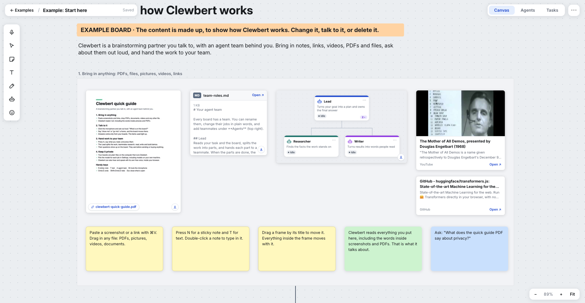

# Clewbert

Boards you can talk to, with a team of AI agents that works on them.



A clew is the ball of thread that led Theseus out of the labyrinth; it is where the word "clue" comes from.
You bring the pile of screenshots, links, PDFs and half-formed ideas. Clewbert and its helpers find the thread.

Paste screenshots, links, PDFs and any file onto an endless canvas, add sticky notes and frames, and pan and zoom
like Miro. Then ask the board questions out loud or by typing, or hand a task to a team of agents: the task becomes a
frame on the board, and the agents fill it with notes, links, working demos and questions for you.

## What it does

- **Canvas:** sticky notes, text, arrows, frames, drawing, emoji, images, videos, PDFs and any dropped file. Copy and paste (also between boards), Option-drag to copy. Boards live in spaces.
- **Talk to your boards:** questions are answered only from what is on the board, with the items it used highlighted. Works from one board, one space, or all boards.
- **Agent teams:** each board has a team: a Lead and teammates with roles in plain words, in an org chart you can rearrange. A task goes to the Lead, who hands parts to teammates (each part is its own frame, joined by an arrow) and writes the final answer. Agents can search the web, read pages and code, use a real browser, and build demos you can open. They ask before anything that sends, buys, books, posts or signs up.
- **Your models, your choice:** in Settings (the gear), pick the model for each job (voice, agents, builders, vision): a model server on your own machine, or OpenAI, xAI or Anthropic with your own key. Keys stay on your server. To use your own model server, pick **Your own** on the welcome screen, or add its address under **Your own model servers** in Settings (anything that serves `/v1/models` the OpenAI way: Ollama, LM Studio, vLLM, llama.cpp); its models then show in each job's list.
- **Connected apps:** in Settings, under **Connected apps**, agents can use your Gmail, Google Drive and Google Calendar, and any MCP tool server you add by address. Nothing goes through a middleman: Clewbert talks to Google directly through a sign-in app you make once in your own Google Cloud account (Settings walks you through it, about 10 minutes, with a link for each step). Reading and searching run on their own; sending an email, adding a calendar event or any tool that changes something waits for your yes on the board. Each board can switch connected apps off. Google only sends you back to an https address or to localhost, so connect Google from `http://localhost:<port>` or from behind https.
- **Miro import:** New board > Import from Miro.

## Run it

Needs macOS (pictures and PDFs are read with Apple's on-device text recognition) and the Python that comes with it. No packages to install.

Optional: phone notifications from your agents (install Clewbert as an app on your phone from the browser menu) need one package, `pip3 install cryptography`. Everything else runs without it.

```
swiftc -O tools/textof.swift -o bin/textof
python3 server.py 8135 ~/clewbert-data
```

Open http://localhost:8135. The first screen asks for one key: **xAI** or **OpenAI** (Clewbert thinks, hears and talks
with it) or **Anthropic** (it thinks; hearing and speaking use Clewbert's own voice, below). The key is checked before
you can go on, every job gets a model from it, and Clewbert starts listening on the Start here board.

**Clewbert's own voice.** Free, open-source models that run in your browser on the graphics chip: Moonshine hears
(MIT) and Kokoro speaks (Apache 2.0). They download once, about 480 MB, and the browser keeps them; what you say never
leaves your computer. It is used with an Anthropic key, and anyone can choose it on the welcome screen or in the voice
card's menu. Chrome or Edge on a recent computer keeps up with a conversation; without WebGPU it works, but slowly. Change models or voices later with the gear (Settings).

The first time it runs, the data folder gets three example boards in an Examples space: **Start here** (a tour of
the app, with a PDF, a Markdown file, a picture, and YouTube and GitHub link cards, and a "Build your first team" button:
Clewbert talks you through building your first agent team out loud, then the team writes a one-page plan for your first
week while you watch), **Product launch brainstorm** (messy research to make sense of) and **Plan a team offsite** (a job ready
for the agent team). Their content is made up. Change them or delete them; deleted ones do not come back.

## Settings at startup (optional)

| Variable | What it is |
|---|---|
| `CANVAS_MODEL_URL`, `CANVAS_MODEL` | A chat/completions model on your own machine (Ollama, LM Studio, vLLM...) for the voice |
| `AGENT_MODEL_URL`, `AGENT_MODEL` | The same for the agents (it must support tool calls) |
| `AGENT_CODE_MODELS` | Stronger models for the Developer and designers: `url|model;url|model`, tried in order |
| `AGENT_VISION_MODEL_URL`, `AGENT_VISION_MODEL` | A model that can see, to check demo screenshots |
| `AGENT_WORKERS` | Tasks at once (default 3) |
| `SEARXNG_URL` | Your own SearXNG for web search (json format on) |
| `BROWSER_URL`, `BROWSER_TOKEN` | A real browser for agents: run `browser/service.py PORT` on any machine with Playwright |
| `CANVAS_TTS_URL` | Your own text-to-speech server (otherwise the OpenAI or xAI key speaks) |
| `CF_ACCESS_TEAM`, `CF_ACCESS_AUD` | If the app sits behind Cloudflare Access |

Choices made in Settings win over these. Hearing and speaking use the OpenAI or xAI key, or Clewbert's own voice.
If you set `CANVAS_TTS_URL`, Clewbert uses your own services instead: that speech server, and a speech-to-text service
at `/ears` next to the app.

**Keep it private.** The key is stored on the machine that runs Clewbert. If you put Clewbert on the internet, put a
sign-in in front of it (Cloudflare Access is supported), or anyone who finds it can use your key.

## Your data

Everything is stored as plain files in the data folder you pass to `server.py`: boards, pictures, files, agent runs,
conversations, `settings.json` (your provider keys) and `integrations.json` (your Google sign-in and tool server keys), both readable only by your user account. `backup.sh` makes a nightly copy.

## Licence

Apache License 2.0. See `LICENSE` and `NOTICE`.
